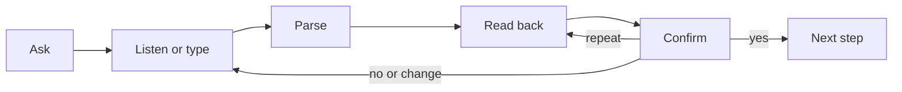

# Voice-first starter kit — PLAN.md

Solo, about 3 hours. One later chat per step below. Swap questions by editing one config file. No login, backend, analytics, stored audio, or features beyond this list.

## Browser limits

Android Chrome is the target. `webkitSpeechRecognition` sends audio to Google, so recognition needs a network even when the app shell is cached. `confidence` is often `0`; show it, and show "—" when it is `0`. Marathi `speechSynthesis` voices are often missing; then show the line on screen. iOS Safari: recognition is missing or unreliable (especially in an installed home-screen app), voices are limited, and install is "Add to Home Screen" only. Firefox has no SpeechRecognition. Typed input and `/demo` still work everywhere.

## Folder structure

```
voice-starter/
  index.html
  vite.config.ts
  public/manifest.webmanifest
  public/icons/          192 and 512
  src/main.tsx
  src/App.tsx            routes / and /demo
  src/index.css
  src/config/steps.ts    the only file to edit per problem
  src/flow/intents.ts    yes / no / repeat / change
  src/flow/useStepFlow.ts
  src/speech/useRecognition.ts
  src/speech/useSpeech.ts
  src/speech/PrivacyNote.tsx
  src/parse/fold.ts
  src/parse/digits.ts
  src/parse/time.ts
  src/parse/keywords.ts
  src/parse/index.ts
  src/storage/store.ts
  src/ui/MicButton.tsx
  src/ui/Shell.tsx
  src/pages/FlowPage.tsx
  src/pages/DemoPage.tsx
```

Deps: Vite, React, TypeScript, Tailwind, react-router, vite-plugin-pwa. System Devanagari font (Nirmala UI, Noto Sans Devanagari, sans-serif). No font CDN.

UI labels are always Marathi and English together. The language switch only sets recognition and speech to `mr-IN`, `hi-IN`, or `en-IN`.

## Behaviour to lock

**Mic.** One large button. Press under 400ms: tap toggles listening. Press of 400ms or more: hold-to-talk, stop on release. Block the browser long-press menu. Show live transcript and confidence. Count a failure on `no-speech`, `network`, or `audio-capture`. After two failures on the current step, show a text field for that step only; clear the count when the step changes. Permission denied shows the same field plus a one-line permission message.

**Privacy.** Before the first `start()`, a blocking note: speech may leave the phone (the browser vendor processes it). One dismiss flag in localStorage. "Delete everything" clears it too.

**Speech out.** `speechSynthesis` in the chosen language, rate 0.9. If `voiceschanged` finds no voice whose `lang` starts with `mr`, `hi`, or `en` for that choice, do not speak; show the same text in a panel.

**Steps.** `steps.ts` is an array of `{ id, prompt: { mr, en }, parse: "text" | "digits" | "time" | "keyword", keywords?: string[] }`. Ship three placeholders (a sentence, a number, a time) so the loop can be tried. Loop per step: show and speak the prompt, listen or accept typed text, parse, speak and show the read-back, listen for confirm. Yes: next step. No or change: listen again. Repeat: speak the read-back again. Closed phrase list only: हो, होय, हाँ, हां, yes; नाही, नहीं, no; पुन्हा सांगा, पुन्हा, फिर से, repeat; बदला, बदलो, change. Match after the Devanagari fold.

**Parser.** No fuzzy library.

- Digits: words for 0–10, tens, and hundred in English, Hindi, and Marathi, plus `0-9` and `०-९`. A run of single digits becomes one number (`nine eight` → `98`). One number-word phrase becomes that number (`पन्नास` → `50`). Else return the raw text.
- Time: only `today|आज` and `yesterday|काल`, with `morning|सकाळ|सुबह` and `night|रात्र|रात्री|रात`. `काल` means yesterday. Return `{ day, part }` or null.
- Keywords: strip matras, halant, nukta, anusvara, visarga, chandrabindu; shorten independent vowels (आ→अ, ई→इ, ऊ→उ, ऐ→ए, औ→ओ); map श/ष→स, ण→न, ळ→ल. A keyword hits if its folded form appears inside the folded utterance.

**Storage.** `store.ts`: `load`, `save`, `clear` on one localStorage key. Save confirmed answers only (id, raw text, parsed value). Visible "Delete everything" / "सर्व काढून टाका" clears that key and the privacy flag. Nothing else is persisted. Transcripts stay in memory.

**Offline.** Service worker precaches the built shell. A banner "No internet" / "इंटरनेट नाही" when `navigator.onLine` is false. The banner does not claim the mic works offline.

**Demo.** `/demo`: a textarea, a Parse button, and the JSON result. No mic on that page.



## Build steps (one chat each)

1. **Scaffold.** Vite React-TS, Tailwind, router, PWA manifest and generated service worker, high-contrast large type, bilingual shell, language switch, empty `/` and `/demo`.
2. **Mic.** `useRecognition` and `MicButton`: tap, hold, three languages, live transcript, confidence, privacy note, two-fail typed field. Try it on `/` with no step loop yet.
3. **Speak.** `useSpeech`: voice match or on-screen text. A temporary "Play" control is enough to test it.
4. **Flow.** `steps.ts`, `intents.ts`, `useStepFlow`. Wire ask, listen, read-back, and confirm. Remove the temporary Play control.
5. **Parser and demo.** `fold`, `digits`, `time`, `keywords`. Run parse before read-back. `/demo` paste box shows the JSON.
6. **Save and offline.** Persist confirmed answers, "Delete everything", offline banner. Check the installed PWA opens the shell with the network off, then mic fails honestly.

Stop at the end of each chat. Do not start the next step in the same chat.

## Test checklist

- Language switch changes recognition `lang` and which voice is chosen.
- Short tap starts and a second tap stops. A long press stops on finger up. No text selection or context menu.
- Transcript updates while speaking. Confidence shows, or "—" when `0`.
- Two forced failures on a step reveal the text field; the next step hides it again.
- Privacy note appears once, blocks the mic, and does not appear again until Delete everything.
- With no Marathi voice, the prompt is visible and nothing is spoken.
- हो, नाही, पुन्हा सांगा, बदला, yes, no, repeat, and Hindi हाँ / नहीं / फिर से / बदलो do the right branch.
- `पन्नास` → 50, `nine eight` → 98, `आज सकाळ` and `yesterday night` parse, `शाळा` matches keyword `साला`.
- Reload shows the saved answers. Delete everything empties them and brings the privacy note back.
- Airplane mode: banner visible, `/demo` still parses, app shell loads after a refresh from the installed icon.
- iOS or Firefox: typed path and `/demo` work; mic failure does not trap the step.