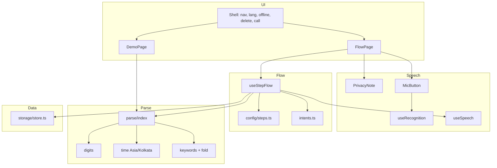

# Voice Kit — complete end-to-end record

One document: **what** this repo is, **why** it exists, **which technologies** it uses, **how** it was built, **which prompts** drove construction, and **what changed** along the way.

**Repository folder:** `D:\voice-kit`  
**App name (package):** `voice-starter`  
**Primary audience:** Solo hackathon in India, **Marathi-first**, mobile-friendly PWA  
**Created:** November 2026 (built in Cursor via agent chats)

---

## 1. What this project is

A **reusable voice-first starter kit**: a small web app that

1. **Asks** questions (configurable),
2. **Listens** via the browser mic (`webkitSpeechRecognition`),
3. **Parses** answers locally (digits, simple times, keywords),
4. **Reads back** via `speechSynthesis` (or shows text if no voice),
5. **Confirms** with spoken/text intents (हो / नाही / पुन्हा / बदला + English/Hindi),
6. **Saves** confirmed answers in `localStorage` only,
7. **Works offline** as an installable PWA shell (mic still needs network).

There is **no backend**, **no login**, **no analytics**, **no API keys**, and **no stored audio**.

**Routes**

| Path | Purpose |
|------|---------|
| `/` | Main **Flow** — mic + 3 placeholder steps |
| `/demo` | **Parser playground** — paste text, see JSON (no mic) |

---

## 2. Why it was built

| Goal | How the kit serves it |
|------|------------------------|
| Fast hackathon prototype | Swap real questions by editing **one file**: `src/config/steps.ts` |
| Low-literacy / voice-first UX | Large mic, bilingual MR+EN labels, TTS + on-screen fallback |
| India / Devanagari | Marathi default, `mr-IN` / `hi-IN` / `en-IN`, local Devanagari folding in parser |
| Works on spotty network | PWA precache + offline banner; typing always available |
| Privacy-aware | Blocking notice before first mic use; “Delete everything” wipes data |

The original planning doc assumed **~3 hours** and **one Cursor chat per build step**. In practice, the project was **built in fewer chats** (one long “build it all” run, then alignment and self-test).

---

## 3. Technology stack (what and why)

| Layer | Choice | Why |
|-------|--------|-----|
| Bundler / dev server | **Vite 8** | Fast HMR, standard React TS template |
| UI | **React 19** + **TypeScript 7** | Component model, type safety |
| Styling | **Tailwind CSS 4** (`@tailwindcss/vite`) | Utility classes, large high-contrast UI quickly |
| Routing | **react-router-dom 7** | `/` and `/demo` |
| PWA | **vite-plugin-pwa 2** + Workbox | Precache built assets; installable on Android Chrome |
| Speech in | **Web Speech API** — `webkitSpeechRecognition` | Only practical free browser STT on Android Chrome |
| Speech out | **`window.speechSynthesis`** | No TTS backend; rate 0.9 |
| Persistence | **`localStorage`** | Answers + privacy dismiss flag only |
| Parser | **Custom TS** (no fuzzy libs) | Small, predictable, offline |
| Lint | **oxlint** | From Vite template |
| Fonts | **System only** — Nirmala UI, Noto Sans Devanagari, sans-serif | No CDN (plan requirement) |

**Explicitly not used:** Node backend, Firebase, Supabase, OpenAI, Whisper API, MediaRecorder persistence, analytics SDKs.

### npm scripts

```bash
npm run dev      # local development (port 5173)
npm run build    # tsc -b && vite build → dist/
npm run preview  # serve dist (port 4173)
npm run lint     # oxlint
```

---

## 4. Architecture (runtime flow)



**Per-step loop (`useStepFlow`):**

1. **Ask** — show bilingual prompt; speak Marathi prompt (short).
2. **Listen** — mic or typed fallback → raw text.
3. **Parse** — according to step `parse` kind.
4. **Read back** — short spoken line + confirm phase.
5. **Confirm** — yes → save & next step; no/change → re-listen; repeat → read back again.

---

## 5. Source layout (every file’s role)

```
D:\voice-kit\
  PLAN.md.md              # Original product/behaviour plan (reference)
  README.md               # Short user guide (run, Vercel, limits)
  VOICE_KIT_END_TO_END.md # This file
  package.json
  vite.config.ts          # React, Tailwind, PWA manifest + Workbox
  index.html
  public/
    manifest.webmanifest
    icons/icon-192.png, icon-512.png
  src/
    main.tsx              # BrowserRouter
    App.tsx               # lang state, routes, delete everything
    index.css             # Tailwind import, dark theme, 18px base
    config/steps.ts       # ONLY file to edit for new hackathon questions
    flow/
      intents.ts          # हो, नाही, पुन्हा, बदला, yes, no, repeat, change…
      useStepFlow.ts      # ask → listen → parse → confirm state machine
    speech/
      useRecognition.ts   # webkit STT, failures, transcript, confidence
      useSpeech.ts        # TTS or on-screen panel
      PrivacyNote.tsx     # Blocking modal before first mic
    parse/
      fold.ts             # Devanagari normalisation for keywords/intents
      digits.ts           # MR/HI/EN number words, digit runs
      time.ts             # today/yesterday + morning/night, Asia/Kolkata
      keywords.ts         # folded substring match
      index.ts            # parseAnswer(), formatParseResult()
    storage/store.ts      # localStorage keys, privacy flag
    ui/
      MicButton.tsx       # tap vs hold (400ms), block context menu
      Shell.tsx           # nav, lang, offline banner, footer buttons
    pages/
      FlowPage.tsx        # wires mic + flow + saved answers list
      DemoPage.tsx        # 5 MR + 5 HI + 5 EN parser examples
    vite-env.d.ts         # SpeechRecognition types, PWA client types
```

### localStorage keys

| Key | Content |
|-----|---------|
| `voice-starter-answers` | JSON array of `{ id, raw, parsed }` (confirmed only) |
| `voice-starter-privacy-dismissed` | `"1"` after user accepts privacy note |

---

## 6. Locked behaviour (product rules)

### Mic (`MicButton` + `useRecognition`)

- **&lt; 400 ms** press → tap toggles listen on/off.
- **≥ 400 ms** → hold-to-talk; release stops.
- `contextmenu` prevented on mic (no long-press menu).
- Live **transcript**; **confidence** shows **`unknown`** when `0` or missing (per final build prompt).
- Failures on **`no-speech`**, **`network`**, **`audio-capture`** increment counter; after **2**, typed field for **current step only**; counter reset on **step change**.
- Permission denied → typed field + message; unsupported browser → typed path.

### Privacy

Exact English copy (final prompt):

> Speech may be sent to your browser's speech service.

Blocks mic until dismissed. **Delete everything** clears answers **and** privacy flag.

### Speech out

- `speechSynthesis`, `rate: 0.9`, voice matching `mr` / `hi` / `en` prefix.
- If no voice → violet **On screen** panel with same text (common on desktop without Marathi voice).

### Parser (no external libs)

- **Digits:** `पन्नास` → 50; `nine eight` / `नऊ आठ` → 98; Devanagari digits ०–९.
- **Time:** `today|आज`, `yesterday|काल|कल`; `morning|सकाळ|सकाळी|सुबह`, `night|रात…`; returns `{ day, part, timezone: "Asia/Kolkata", localISO }` (08:00 morning, 21:00 night IST).
- **Keywords:** fold Devanagari (matras, श/ष→स, ळ→ल, ण→न, long vowels→short) then substring match.

### Confirm phrases (`intents.ts`)

हो, होय, हाँ, हां, yes → yes  
नाही, नहीं, no → no  
पुन्हा सांगा, पुन्हा, फिर से, repeat → repeat  
बदला, बदलो, change → change  

### Offline

- Service worker precaches built shell.
- Banner: **इंटरनेट नाही, टाइप करता येईल. / No internet, you can type.**

### Footer (always visible)

- **सर्व काढून टाका / Delete everything** — works.
- **कॉल / Call (placeholder)** — disabled placeholder (final prompt).

### Placeholder steps (`steps.ts`)

1. Sentence (`text`)  
2. Number (`digits`)  
3. Time (`time`)

---

## 7. Browser targets and limits

| Browser | Mic STT | TTS (mr-IN) | Install PWA |
|---------|---------|-------------|-------------|
| **Android Chrome** | Best; needs network | Often OK | Add to Home screen |
| **iOS Safari** | Unreliable / missing | Limited | Add to Home Screen |
| **Firefox** | Not supported | Varies | Limited |

Audio is processed by the **browser vendor** (e.g. Google for Chrome recognition). Precached shell can load offline; **recognition does not work offline** in practice.

---

## 8. Build history and prompts used (Cursor)

All work happened in folder **`D:\voice-kit`** only. Git was **`git init`**’d; files are **staged**, **no commit** as of this document (unless you committed later).

### Chat / session timeline

| Order | User prompt (summary) | What the agent did |
|-------|----------------------|--------------------|
| **1** | Read `PLAN.md` in project root; build whole starter per plan steps; `npm install`, `npm run build`, fix errors; tell user what to test | Scaffolded Vite React-TS in `temp-voice` → moved to root; installed Tailwind, router, PWA; implemented all plan modules (mic, speech, flow, parser, storage, pages); first successful `npm run build` |
| **2** | Long **phased prompt** (Phases 1–4): full spec with `unknown` confidence, exact privacy string, Call placeholder, demo 5+5+5 examples, README, `git init`; build and fix | Aligned app to phased prompt; fixed `DemoPage` JSX (`<motion>` tag error); `npm run build` pass; `git init` + staged files |
| **3** | “Test yourself all against prompt” | Automated parser/intent tests; browser test on preview; fixed **Hindi `कल रात`** (yesterday) in `time.ts`; fixed **Devanagari matra stripping** `U+093E–0940` in `fold.ts` for keyword match in sentences like `मी शाळेत जातो` |
| **4** | (System) Preview server stopped after tests | Informational only — not a build failure |
| **5** | “All end-to-end info in one file…” | Created **this document** |

### Source-of-truth documents

1. **`PLAN.md.md`** — original architecture and behaviour (written before code).
2. **Phased user prompt (chat 2)** — overrides plan where different (e.g. confidence `unknown`, privacy English string, Call button, offline banner wording, demo examples).
3. **`README.md`** — short operational guide.

### Plan vs shipped differences

| Topic | PLAN.md.md | Shipped (followed later prompt) |
|-------|------------|----------------------------------|
| Confidence when 0 | Em dash `—` | **`unknown`** |
| Privacy copy | “may leave the phone” | **Browser speech service** (exact English) |
| Offline banner | “No internet” only | **“you can type”** |
| Time parse return | `{ day, part }` | Adds **`timezone`**, **`localISO`** (Asia/Kolkata) |
| Time yesterday | `काल` | Also **`कल`** (Hindi demo) |
| Call button | Not in plan | **Placeholder** in footer |
| Demo page | Textarea only | **15 clickable examples** |

---

## 9. Issues found and fixed during self-test

| Issue | Symptom | Fix |
|-------|---------|-----|
| DemoPage build error | Invalid `<motion>` JSX | Replaced with `<div>` |
| Hindi time example | `कल रात` → `null` | Added `कल` alongside `काल` in `time.ts` |
| Keyword in sentence | `शाळेत` vs keyword `साला` failed | Extended matra regex in `fold.ts` to include `U+093E–0940` |
| Vite scaffold in non-empty dir | `create-vite .` cancelled | Scaffolded in `temp-voice`, moved files up |

---

## 10. How to run, test, and deploy

### Run

```bash
cd D:\voice-kit
npm install
npm run dev
```

### Production

```bash
npm run build
npm run preview
```

### Deploy (Vercel)

- Framework: **Vite**  
- Build: `npm run build`  
- Output: `dist`  
- Use HTTPS URL for PWA install and mic permissions.

### Swap questions (hackathon)

Edit **`src/config/steps.ts`** only — change `prompt`, `parse`, or `keywords`.

### Manual test checklist (condensed)

- Privacy blocks mic once; Delete brings it back.
- Lang switch → `rec.lang` + TTS voice.
- Tap / hold mic; transcript; confidence `unknown` on desktop.
- Two STT failures → type field; next step clears failures.
- `/demo` — 15 examples; JSON output.
- Confirm intents in MR/HI/EN.
- Reload — saved answers; Delete clears all.
- Airplane mode — banner; `/demo` still parses.

---

## 11. What you can extend next (not built)

- Wire **Call** to `tel:` or your helpline API.
- Add real hackathon steps and keyword lists in `steps.ts`.
- Optional: unit test file for `parse/*` and `intents.ts` in CI.
- `git commit` initial snapshot when ready.

---

## 12. Quick reference — dependencies (`package.json`)

**dependencies:** `react`, `react-dom`, `react-router-dom`, `vite-plugin-pwa`  
**devDependencies:** `vite`, `@vitejs/plugin-react`, `typescript`, `tailwindcss`, `@tailwindcss/vite`, `oxlint`, `@types/*`

---

## 13. One-line summary

**Voice Kit** is a Marathi-first, client-only PWA template: configure questions in `steps.ts`, run on Android Chrome for voice, fall back to typing everywhere else, parse locally, store answers in the browser, and ship hackathon flows without a backend.

---

*Document generated for project history and onboarding. For day-to-day commands, see `README.md`. For original behaviour spec, see `PLAN.md.md`.*