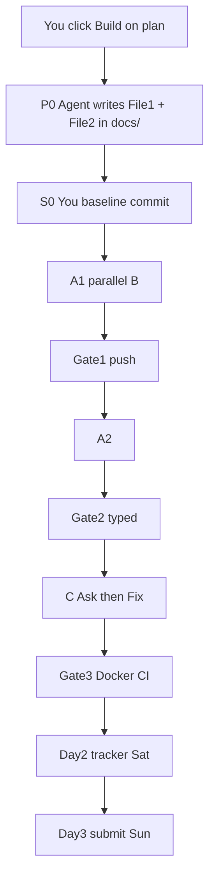

# BimaBol: two strong repo files + folder truth

## What exists right now (audit of `D:\voice-kit`)

| Area | Present | Missing for [SPEC.md](d:\voice-kit\SPEC.md) |
|------|---------|---------------------------------------------|
| **Git** | `git init`, all starter **staged**, branch `master`, **zero commits** | Baseline commit, `main`, remote `bimabol`, pushes |
| **docs/** | [round1.txt](d:\voice-kit\docs\round1.txt) only | `DECK.md`, `DEMO_SCRIPT.md`, **your two runbook files** |
| **Package** | `voice-starter`, scripts: dev/build/lint/preview | Rename `bimabol`, **`npm test`**, dexie, vitest |
| **Routes** | `/`, `/demo` in [App.tsx](d:\voice-kit\src\App.tsx) | `/report`, `/case/:id`, `/about`; Home with case cards |
| **Reuse as-is** | [src/speech/*](d:\voice-kit\src\speech), [src/ui/MicButton.tsx](d:\voice-kit\src\ui\MicButton.tsx), [src/flow/intents.ts](d:\voice-kit\src\flow), [src/parse/*](d:\voice-kit\src\parse) (extend), PWA | Migrate storage localStorage → Dexie |
| **Infra** | None | Dockerfile, docker-compose, nginx, `.github/workflows/ci.yml`, vercel.json |
| **Plans in repo** | [SPEC.md](d:\voice-kit\SPEC.md), [BimaBol_Round2_Master_Plan.md](d:\voice-kit\BimaBol_Round2_Master_Plan.md), [VOICE_KIT_END_TO_END.md](d:\voice-kit\VOICE_KIT_END_TO_END.md) | Master Plan can stay **outside** public repo if you prefer; runbooks go **in** `docs/` |

**Important:** The Cursor file `bimabol_today_e2e_*.plan.md` is **not** your runbook. You asked for **two files inside the project** — they are **not created yet**. Step **P0** (first Agent job after you click Build) writes them.

---

## The two files (names, roles, no overlap)

| File | Path | Audience | Updates |
|------|------|----------|---------|
| **File 1 — Today runbook** | [docs/TODAY_PROMPT_RUNBOOK.md](d:\voice-kit\docs\TODAY_PROMPT_RUNBOOK.md) | You, every **new Cursor chat today** | Static prompts; tiny edits only if A1 splits |
| **File 2 — 3-day tracker** | [docs/ROUND2_THREE_DAY_TRACKER.md](d:\voice-kit\docs\ROUND2_THREE_DAY_TRACKER.md) | You, **after every step** | Checkboxes, dates, **Completed X / Total Y** |

File 1 **ends at tonight’s goal** (code + test + docker + GitHub green). File 2 **covers Fri 27 → Mon 30** submission (Master Plan §4). File 1 points to File 2 for Sat–Mon; File 2 points to File 1 for copy-paste prompts.

---

## File 1 — full table of contents (`TODAY_PROMPT_RUNBOOK.md`)

Write this as one long operational manual (~sections below).

### §0 How to use Cursor today (deep)

- **Folder:** open `D:\voice-kit` only.
- **Settings:** Agent (not Plan) for all build prompts; **This PC**; Composer 2.5 Fast; Auto **off**; no Multitask.
- **When Plan mode:** only to re-scope (e.g. A1 failed twice → use A1a/A1b); not for A1/B/A2.
- **When Ask mode:** Chat C review only (Grok 4.7 Medium).
- **When you (human):** S0, Gate 1/2/3, git push, browser tests — use **cmd** in `D:\voice-kit`.
- **One chat = one prompt block.** Never two agents editing `src/` at once except the designed split: **A1 ∥ B** (different paths).
- **After each Agent chat:** run terminal `npm run build` and `npm test`; then run **TRACK** mini-prompt (below) to update File 2.
- **Wispr Flow (optional):** dictate prompts; mention in README only if you used it.

### §1 Today’s definition of done (Fri 27)

- [ ] `npm run build` and `npm test` pass locally
- [ ] Typed journey passes Master Plan §10.1 (Gate 2)
- [ ] `docker compose up --build` on clean clone → `http://localhost:8080` main screen, no `.env`
- [ ] Public GitHub `bimabol` pushed; **Actions green**
- [ ] Tracker File 2: **Day 1** steps marked complete

**Not required tonight:** YouTube, deck PDF, portal submit, full Android voice (→ Day 2 in File 2).

### §2 Remaining code map (starter → BimaBol)

Bullet list for agents and you:

- **Keep/extend:** speech hooks, MicButton, intents, fold/digits/time/keywords, Shell patterns, PrivacyNote, PWA config.
- **Replace/extend:** `storage/store.ts` → Dexie + profiles; `config/steps.ts` → report flow or new `src/domain/*`; routes in App.tsx.
- **New pure modules (testable):** `clock.ts`, `eventTime.ts`, `hashChain.ts`, extended `reportParser.ts`, 36 districts.
- **New UI pages:** Home, Report (steps 1–6), Case, About; extend Demo per SPEC.
- **Infra (Chat B only):** Dockerfile, nginx, compose, CI, vercel.json, SECURITY.md, README sections.

### §3 Cursor settings cheat sheet

Table: Step ID | Mode | Model | May edit | Must not edit | Run after |

(include S0, A1, A1a, A1b, B, A2, C-ASK, C-FIX, 8.7–8.9, TRACK, E marked DAY 2)

### §4 Line-by-line sequence (today only)

Numbered list **1…N** with:

`# | Step ID | Who | Mode | Model | After step # | Gate before next? | Est. min`

Sequence:

1. **TRACK-INIT** (Agent) — “Initialize ROUND2_THREE_DAY_TRACKER.md Day 1 table; do not change src.”
2. **S0** (You) — full commands from Master Plan §5 (baseline commit, SPEC already on disk, `docs/round1.txt`, remote).
3. **A1** (Agent) — full prompt §8.1 (entire fenced block verbatim from [BimaBol_Round2_Master_Plan.md](d:\voice-kit\BimaBol_Round2_Master_Plan.md)).
4. **B** (Agent, **parallel with 3**) — full prompt §8.2 verbatim.
5. **You** — local verify both: `npm install`, `npm run build`, `npm test`.
6. **GATE1** (You) — §9 push block verbatim.
7. **TRACK** (Agent) — prompt template §7 below.
8. **A2** (Agent) — §8.3 verbatim.
9. **GATE2** (You) — §10.1 checklist copied in full into File 1 appendix.
10. **TRACK**
11. **C-ASK** (Ask) — §8.4 first block.
12. **C-FIX** (Agent) — §8.4 second block.
13. **GATE3-DOCKER** (You) — §10.2 commands.
14. **GATE3-CI** (You) — Actions tab.
15. **TRACK** — mark Day 1 complete in File 2.

**Fallback prompts** (full text in appendix): A1a, A1b, 8.7 Generic, 8.8 Docker, 8.9 Voice (voice = Day 2 but text included for copy-paste).

### §5–§12 Appendices (all in File 1)

- **§5** S0 command block (cmd)
- **§6** GATE1 git block (cmd)
- **§7 TRACK agent prompt** (fixed template):

```text
Read docs/ROUND2_THREE_DAY_TRACKER.md. Mark step [STEP_ID] as COMPLETE with today's date and time (IST). Recompute "Day 1: X/Y complete" and "Round 2 overall: A/B complete". List the single next step ID and which file section to open (TODAY_PROMPT_RUNBOOK or ROUND2). Do not edit src/ unless I say a gate failed.
```

- **§8** Full prompts 8.1–8.9 (copy from Master Plan — no shortening)
- **§9** Gate 2 checklist §10.1 (every checkbox)
- **§10** Commands: `npm run dev`, `npm test`, docker clone test
- **§11** Gotchas §7 Master Plan (12 items, short symptom → fix)
- **§12** What starter already passes (from VOICE_KIT_END_TO_END.md §6) so agents do not rebuild mic/parser

---

## File 2 — full table of contents (`ROUND2_THREE_DAY_TRACKER.md`)

Living document; top of file always shows:

```markdown
**Round 2 overall:** 0 / 28 steps complete  
**Day 1 (Fri 27):** 0 / 12 — TODAY code + test + push  
**Day 2 (Sat 28):** 0 / 8 — review, Docker phone, CI  
**Day 3 (Sun 29):** 0 / 6 — polish, video, deck, submit  
**Buffer (Mon 30):** 0 / 2 — fixes only, submit by 6 PM latest  
**Deadline:** Mon 30 Nov 2026, 11:59 PM IST | **Repo:** github.com/YOUR-USERNAME/bimabol
```

### Day 1 — Fri 27 (links to File 1 §4)

| ID | Task | Owner | Done | Time |
|----|------|-------|------|------|
| D1-01 | Tools + baseline commit | You | [ ] | |
| D1-02 | A1 core app + tests | Agent | [ ] | |
| D1-03 | B infra + DECK/DEMO_SCRIPT md | Agent | [ ] | |
| D1-04 | Local build + test | You | [ ] | |
| D1-05 | Gate 1 push + secret scan | You | [ ] | |
| D1-06 | A2 case flow | Agent | [ ] | |
| D1-07 | Gate 2 typed E2E | You | [ ] | |
| D1-08 | C Ask review | Ask | [ ] | |
| D1-09 | C Agent fix | Agent | [ ] | |
| D1-10 | Docker clean clone | You | [ ] | |
| D1-11 | CI green | You | [ ] | |
| D1-12 | Day 1 sign-off | You | [ ] | |

### Day 2 — Sat 28 (Master Plan §4 Saturday)

C review if moved; Docker re-check; **Vercel** §11; **Android voice** §10.3; voice-fix prompts; Gate 3 final; optional Chat D; commit/push.

### Day 3 — Sun 29 (Master Plan §4 Sunday)

Chat **E** §8.6; friend test §10.5; record **YouTube** §12; **deck PDF** from `docs/DECK.md` §13; **Gate 4** §10.4 + **submit** §14. **No new features after 6 PM.**

### Buffer — Mon 30

Fixes only; submit by 6 PM if not done; portal closes 11:59 PM; keep Vercel until 2 Dec.

### Submission pack checklist (Day 3)

Hackathon table: GitHub | Demo video | Deck PDF | Live link (optional).

### Testing matrix (all days)

| When | What | Reference |
|------|------|-----------|
| After A1/A2/C | `npm test`, `npm run build` | SPEC TESTS |
| Day 1 evening | Gate 2 typed | §10.1 |
| Day 1/2 | Docker clone | §10.2 |
| Day 2 | Android 7 sentences | §10.3 |
| Day 3 | Friend clone | §10.5 |
| Day 3 | Gate 4 | §10.4 |

### Cut order if behind (from Master Plan §4)

Never cut: Docker, tests, typed/voice report path, clock, 14447 script, ticket, tamper log, safety text.

---

## Voice Kit docs diff (one paragraph in File 1 §0)

- **Repo** [VOICE_KIT_END_TO_END.md](d:\voice-kit\VOICE_KIT_END_TO_END.md): documents **built starter** in this folder.
- **Hackathon attachment** `VOICE-KIT-END-TO-END.md`: **research only**, no code — do not use as runtime spec.
- **Build spec:** SPEC.md + Master Plan §8 prompts.

Round 1 [docs/round1.txt](d:\voice-kit\docs\round1.txt): Sarvam/`/api/extract` = **out of scope** for this repo (deck: “future”).

---

## Execution order after you approve Build



1. **P0** — only creates the two markdown files (can commit with baseline or after S0).
2. **You** follow File 1 §4 line by line; update File 2 via **TRACK** prompt or manual ticks.
3. Do **not** start A1 until File 1 exists (so you have verbatim prompts in-repo).

---

## Clarification vs last plan

- Previously: one Cursor plan file + vague names `CURSOR_PROMPT_RUNBOOK` / `E2E_BUILD_PLAN`.
- Now: **two explicit repo paths**, File 1 = **today + deep Cursor how-to + all prompts**, File 2 = **3-day submission + counters** updated after each step.
- **P0 first deliverable** is both files at full length (not stubs).

When you are ready for files on disk and build work, reply **Build** or **execute the plan** in Agent mode.